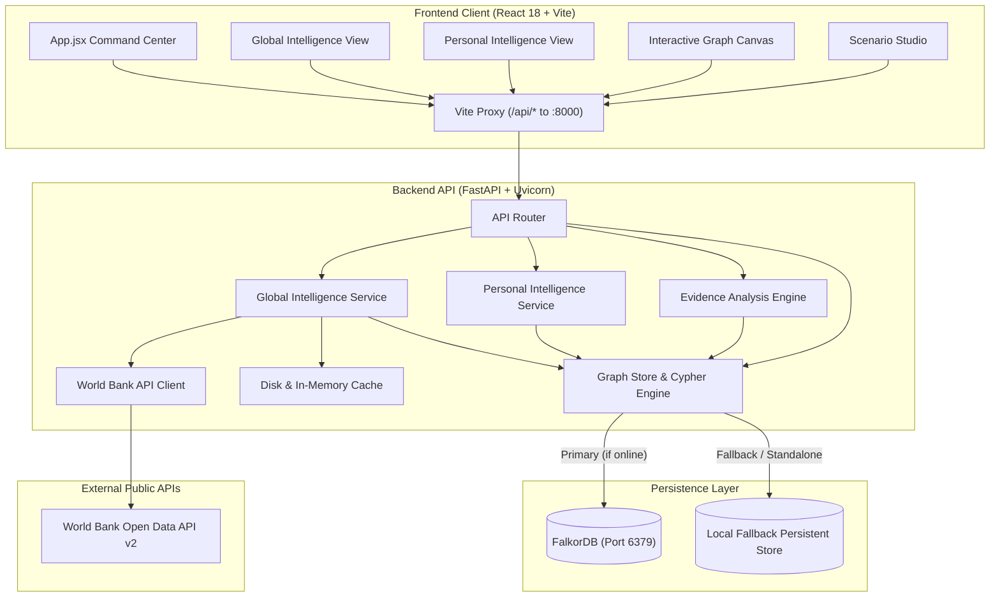

# GlobalDataMind AI — Intelligent Multi-Domain Intelligence Platform

**GlobalDataMind AI** is a graph-native multi-domain intelligence platform combining real-time World Bank global indicators, personal academic credential tracking, enterprise dependency ripple analytics, and evidence-grounded AI reasoning.

---

## 🌟 Core Modules

### 1. 🌍 Global Intelligence
- **World Bank API Integration**: Direct retrieval of macro-economic, demographic, and environmental indicators for 50+ countries.
- **Key Indicators**: GDP (`NY.GDP.MKTP.CD`), GDP per capita (`NY.GDP.PCAP.CD`), Total Population (`SP.POP.TOTL`), Inflation (`FP.CPI.TOTL.ZG`), Unemployment (`SL.UEM.TOTL.ZS`), Education Expenditure (`SE.XPD.TOTL.GD.ZS`), Internet Adoption (`IT.NET.USER.ZS`), and CO2 emissions (`EN.ATM.CO2E.PC`).
- **Interactive Multi-Country Comparison**: Real-time cross-country benchmarking with multi-year time-series analysis (1960–2025).
- **Persistent Observation Storage**: Observations are stored as `(:Country)`, `(:Indicator)`, and `(:Observation)` nodes linked via `[:HAS_INDICATOR]` and `[:RECORDED_OBSERVATION]`.

### 2. 🎓 Personal Intelligence
- **Verified Academic Progression**: Structured tracking for Class 10 (Secondary), Class 12 (Higher Secondary), and B.Tech / Undergraduate milestones.
- **Dual Verification Model**:
  - `ACTUAL_RECORD`: Strict ground truth (user-submitted credentials, roll numbers, institutions).
  - `CALCULATED_INSIGHT`: Derived metrics (normalized percentage, GPA conversions, progression trends, gap analysis).
- **Privacy Mode**: Instant masking of sensitive identifiers, institutions, and registration numbers.

### 3. 🧠 Enterprise Knowledge Graph & Ripple Intelligence
- **Bitemporal Tracking**: Distinguishes valid-time (real-world event window) from recorded-time (system ingestion timestamp).
- **Ripple Intelligence**: Bounded multi-hop dependency traversal to determine downstream blast radius, risk severity, and mitigation paths.
- **Why-Memory**: Ingests and answers organizational queries on architectural and strategic decisions without LLM hallucination.
- **Counterfactual Scenario Studio**: Side-by-side sandbox simulation for service downtimes and resource reallocations.
- **Trust Ledger**: Cryptographically verifiable evidence ledger exposing groundedness score, citations, and explicit assumptions.

### 4. 🤖 Evidence-Based AI Reasoning Engine
- **Zero Hallucination Policy**: Every statistical claim must trace to a verified database observation or ground-truth record.
- **Confidence Scoring & Citations**: Outputs groundedness metrics (0.0 to 1.0) and citations for all analytical conclusions.
- **Cross-Domain Analysis**: Generates dedicated socio-economic indicator reports and academic trajectory evaluations.

---

## 🏛️ System Architecture



---

## 🚀 Getting Started

### Prerequisites
- Python 3.10+ (tested on Python 3.12)
- Node.js 18+ & npm
- (Optional) Docker Desktop if running FalkorDB container

---

### Quick Start (From Root Workspace)

```powershell
# 1. Install root & frontend dependencies
npm install --prefix frontend

# 2. Start Backend API (FastAPI) on port 8000
npm run backend

# 3. Start Frontend Client (Vite) on port 5173
npm run dev
```

- **Frontend App**: [http://localhost:5173](http://localhost:5173)
- **Backend API**: [http://127.0.0.1:8000](http://127.0.0.1:8000)
- **Interactive Swagger Docs**: [http://127.0.0.1:8000/docs](http://127.0.0.1:8000/docs)
- **Health Check**: [http://localhost:5173/api/health](http://localhost:5173/api/health)

---

### Manual Execution (Separate Terminals)

#### Terminal 1: Backend
```powershell
cd backend
python -m pip install -r requirements.txt
python -m uvicorn app.main:app --host 0.0.0.0 --port 8000 --reload
```

#### Terminal 2: Frontend
```powershell
cd frontend
npm install
npm run dev
```

---

## 🧪 Testing & Verification

### Run Backend Unit & Integration Tests (67 tests)
```powershell
# In PowerShell:
$env:PYTHONPATH="backend"
pytest backend/tests -v
```

All 6 test suites pass cleanly:
1. `test_api.py`: Core routing, health check, Cypher console, and knowledge ingestion.
2. `test_evidence_analysis.py`: Evidence-based AI reasoning and citation validation.
3. `test_global_intelligence.py`: World Bank API integration, search, and indicator queries.
4. `test_observation_persistence.py`: Graph and SQLite observation persistence and deduplication.
5. `test_personal_intelligence.py`: Academic milestone tracking, timeline, and privacy masking.
6. `test_temporal_and_realtime.py`: Bitemporal validity and realtime event streaming.

### Run Frontend Production Build
```powershell
npm run build
# Or from frontend: cd frontend && npm run build
```

---

## 📡 Core API Reference

### Global Intelligence
| Method | Endpoint | Description |
|---|---|---|
| `GET` | `/api/global/countries` | List 50+ supported countries with income level & region |
| `GET` | `/api/global/indicators` | List supported socio-economic indicators |
| `GET` | `/api/global/observations` | Fetch historical observations for country & indicator |
| `POST` | `/api/global/compare` | Multi-country comparison across specified years |
| `POST` | `/api/global/sync` | Force refresh observations from World Bank API |

### Personal Intelligence
| Method | Endpoint | Description |
|---|---|---|
| `GET` | `/api/personal/profile` | Complete profile with timeline, gaps, and calculated metrics |
| `POST` | `/api/personal/record` | Add or update an academic milestone |
| `DELETE`| `/api/personal/record/{id}`| Delete an academic milestone |
| `POST` | `/api/personal/privacy-mode`| Toggle privacy masking on personal data |

### AI Reasoning Engine
| Method | Endpoint | Description |
|---|---|---|
| `POST` | `/api/ai/analyze-global` | Evidence-based analysis of macro-economic indicators |
| `POST` | `/api/ai/analyze-personal`| Evidence-based trajectory analysis of academic records |
| `POST` | `/api/chat` | Graph-grounded conversational reasoning pipeline |

### Enterprise Graph Core & System
| Method | Endpoint | Description |
|---|---|---|
| `GET` | `/api/health` | Service status, graph topology counts, and storage mode |
| `GET` | `/api/decisions` | Query persistent Why-Memory decisions |
| `POST` | `/api/scenarios/compare` | Simulate hypothetical organizational scenarios |
| `GET` | `/api/trust-ledger` | Audit log of AI reasoning sessions and verifiable claims |
| `POST` | `/api/cypher` | Parameterized Cypher query engine |

---

## 🛡️ Data Integrity & Resilience

1. **Persistent Dual Storage**: When Docker Desktop / FalkorDB is offline, GlobalDataMind AI seamlessly switches to a local persistent SQLite + memory engine. It never displays mock data as connected state.
2. **Provenance & Source Tracking**: Every data point records its data source (`World Bank Open Data API v2` or `User Submission (Self-Attested)`), retrieval timestamp, and verification flag.
3. **No Metric Fabrication**: If a metric or year is missing from the World Bank API or user records, it is reported as `null` / `NOT_RECORDED`. Calculations are strictly separated into `CALCULATED_INSIGHT` objects.

